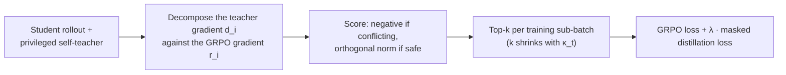

<div align="center">

<h1>GIFT</h1>

<h3>Gradient-Informed FilTering for Distillation-Augmented Reasoning RL</h3>

[](https://huggingface.co/datasets/Leyiii/RLCSD)

<p>
  <a href="#-overview">Overview</a> •
  <a href="#-method">Method</a> •
  <a href="#-results">Results</a> •
  <a href="#-getting-started">Getting Started</a> •
  <a href="#configuration">Configuration</a> •
  <a href="#-citation">Citation</a>
</p>

<p><i>"Thoughts without content are empty, intuitions without concepts are blind."</i> — Immanuel Kant</p>

</div>

---

## 📖 Overview

Reasoning LLMs are trained with two complementary signals: **sparse, outcome-grounded RL** (GRPO) and **dense, token-level self-distillation** (OPSD). Complementary supervision is not the same as compatible optimization, because the teacher's imitation gradient can work against the verifier's reward. **GIFT** chooses which teacher updates to apply, token by token. It splits each token's distillation gradient into a component **parallel** to the RL gradient (conflict → *safety*) and a component **orthogonal** to it (novel direction → *value*), then shrinks the set of distilled tokens with a **coverage-annealing** schedule until training reduces to pure GRPO.

<table>
<tr>
<td width="25%" align="center"><b>🛡️ Safety filter</b><br/><sub>The sign of the parallel component <i>a<sub>i</sub></i> detects first-order conflict with the RL update</sub></td>
<td width="25%" align="center"><b>🧭 Value measure</b><br/><sub>The orthogonal norm <i>b<sub>i</sub></i> measures guidance that rescaling the RL gradient cannot reproduce</sub></td>
<td width="25%" align="center"><b>⚡ Closed-form scoring</b><br/><sub>O(M) per token from forward-pass statistics. No extra backward pass and no |V|-sized gradient</sub></td>
<td width="25%" align="center"><b>📉 Coverage annealing</b><br/><sub>The token budget shrinks while λ stays at 1. Conflicting tokens are dropped first, and training ends as pure GRPO</sub></td>
</tr>
</table>

## 🧠 Method



At each token, GIFT splits the distillation gradient $d_i$ into a part **parallel** to the RL gradient $r_i$ (signed conflict $a_i$) and a part **orthogonal** to it (novelty $b_i$). Conflicting tokens ($a_i < 0$) score negative and rank last; safe tokens ($a_i \ge 0$) are ranked by $b_i$. Taking the top-$k$ scores provably minimizes admitted conflicts first, then their severity, then maximizes injected novelty (Theorem 3 in the paper).

A **coverage-annealing** schedule shrinks $k$ over training: full coverage during an initial hold, then a linear ramp down to zero, at which point the teacher is skipped entirely and training is pure GRPO. The distillation weight $\lambda$ stays fixed — GIFT controls **who** receives guidance, not **how strongly**.

> [!NOTE]
> See the paper (§3) for the full derivation, or [`GIFT_MICROBATCH_TOKEN_ONLY_COMPLETE_IMPLEMENTATION.md`](scripts/gift/main/GIFT_MICROBATCH_TOKEN_ONLY_COMPLETE_IMPLEMENTATION.md) for how it maps onto this code.

## 📊 Results

**Mathematical reasoning** (mean@12, %). Training data is DeepMath-103K. Avg. is the mean over AMC23, AIME24 and AIME25. For OLMo-3-7B-Think, Avg. is the mean over AMC23 and AIME25.

| Model | BASE | GRPO | OPSD | Strongest baseline | **GIFT** |
| :--- | :---: | :---: | :---: | :---: | :---: |
| Qwen3-1.7B | 51.65 | 52.18 | 51.50 | 53.20 <sub>(UFT)</sub> | **54.25** <sub>(+5.03%)</sub> |
| Qwen3-4B | 74.67 | 75.65 | 76.18 | 76.85 <sub>(LUFFY)</sub> | **77.20** <sub>(+3.39%)</sub> |
| Qwen3-8B | 76.67 | 76.64 | 77.46 | 78.04 <sub>(OPDVR)</sub> | **78.96** <sub>(+2.99%)</sub> |
| OLMo-3-7B-Think | 78.36 | 78.29 | 78.78 | 79.58 <sub>(RLCSD)</sub> | **80.70** |

**Logical reasoning.** Knights-and-Knaves, pass@1, %. The model trains on 4–8 roles. Evaluation covers in-distribution (ID) puzzles and out-of-distribution (OOD) puzzles with 9–11 roles.

| Split | BASE | GRPO | OPSD | Strongest baseline | **GIFT** |
| :--- | :---: | :---: | :---: | :---: | :---: |
| Avg. (ID + 3 OOD) | 60.60 | 61.85 | 61.95 | 61.95 <sub>(OPSD)</sub> | **62.85** <sub>(+3.71%)</sub> |

GIFT's largest gains are on the hardest benchmark, AIME25: **+9.51%** (1.7B), **+9.13%** (4B) and **+8.02%** (8B) relative to BASE.

<details>
<summary><b>Full math table (all nine baselines)</b></summary>

| Size | Bench. | BASE | GRPO | OPSD | SDPO | RLSD | RLCSD | OPDVR | LUFFY | UFT | **GIFT** |
| :--- | :--- | :---: | :---: | :---: | :---: | :---: | :---: | :---: | :---: | :---: | :---: |
| 1.7B | AMC23 | 75.50 | 75.70 | 75.60 | 75.30 | 75.30 | 75.80 | 76.51 | 75.40 | 74.60 | 75.80 |
| | AIME24 | 44.44 | 45.28 | 45.56 | 44.72 | 44.72 | 46.94 | 46.67 | 48.33 | 48.33 | **48.61** |
| | AIME25 | 35.00 | 35.56 | 33.33 | 36.67 | 34.72 | 34.72 | 35.83 | 34.17 | 36.67 | **38.33** |
| | Avg. | 51.65 | 52.18 | 51.50 | 52.23 | 51.58 | 52.49 | 53.00 | 52.63 | 53.20 | **54.25** |
| 4B | AMC23 | 88.45 | 89.16 | 88.25 | 88.96 | 88.86 | 90.26 | 88.45 | 89.16 | 89.66 | 88.55 |
| | AIME24 | 71.67 | 74.17 | 73.06 | 70.83 | 73.61 | 72.22 | 73.61 | 76.11 | 70.56 | 73.33 |
| | AIME25 | 63.89 | 63.61 | 67.22 | 67.22 | 63.61 | 64.17 | 64.72 | 65.28 | 64.72 | **69.72** |
| | Avg. | 74.67 | 75.65 | 76.18 | 75.67 | 75.36 | 75.55 | 75.59 | 76.85 | 74.98 | **77.20** |
| 8B | AMC23 | 89.16 | 89.36 | 88.76 | 89.56 | 88.76 | 89.26 | 89.96 | 89.96 | 88.86 | 89.66 |
| | AIME24 | 75.00 | 74.72 | 77.22 | 75.83 | 75.28 | 76.11 | 74.44 | 73.33 | 76.11 | 76.11 |
| | AIME25 | 65.83 | 65.83 | 66.39 | 66.39 | 69.72 | 68.06 | 69.72 | 67.50 | 66.39 | **71.11** |
| | Avg. | 76.67 | 76.64 | 77.46 | 77.26 | 77.92 | 77.81 | 78.04 | 76.93 | 77.12 | **78.96** |

</details>

<details>
<summary><b>Ablations on Qwen3-8B (math Avg., mean@12)</b></summary>

| Group | Variant | Avg. |
| :--- | :--- | :---: |
| Token selection | All tokens / Random tokens | 77.49 / 77.20 |
| | Entropy–KL (TIP Q3) / Gradient-cosine | 76.92 / 77.63 |
| | Conflict-only / Residual-only / Teacher-norm | 77.08 / 76.97 / 76.90 |
| | Conflict-free (hard-exclude $a_i<0$) | 77.73 |
| Allocation scope | Per-rollout / Per-prompt | 77.37 / 77.45 |
| Teacher withdrawal | Sequential OPSD → GRPO / Weight annealing | 77.37 / 76.09 |
| Schedule $(H, T_\text{exit})$ | Linear (0, 78) / (20, 78) / (10, 50) / (10, 90) | 78.03 / 77.26 / 77.46 / 77.64 |
| | Cosine (10, 78) / (0, 78) | 77.93 / 77.02 |
| **GIFT** | **Linear (10, 78), sub-batch scope, coverage annealing** | **78.96** |

</details>

## 🚀 Getting Started

### Requirements

- Linux with NVIDIA GPUs and CUDA 12.x. The launcher defaults `CUDA_HOME` to `/usr/local/cuda-12.6`.
- Python ≥ 3.10, as required by the vendored verl.
- One or more nodes. The shipped configs use the paper's 2 nodes × 16 GPUs, but the layout is set in the config (see [Changing the schedule or topology](#changing-the-schedule-or-topology)).
- Main dependencies: PyTorch `>=2.5,<2.10`, vLLM, FlashAttention, Ray and Hydra. A modified copy of [verl](https://github.com/volcengine/verl) `0.8.0.dev` is vendored in [`third_party/verl`](third_party/verl).

### Installation

Run from the repository root:

```bash
pip install -r requirements.txt
pip install -r third_party/verl/requirements.txt
```

`requirements.txt` pins torch below 2.10, because later wheels target CUDA 13. To match CUDA 12.6 exactly, install torch from the PyTorch index:

```bash
pip install "torch>=2.5.0,<2.10" --index-url https://download.pytorch.org/whl/cu126
```

The vendored verl does not need to be installed. The launchers put `third_party/verl` and the GIFT runtime on `PYTHONPATH` themselves.

### Data and models

Training and evaluation parquets live at [Leyiii/RLCSD](https://huggingface.co/datasets/Leyiii/RLCSD) on the Hugging Face Hub — the same dataset repo used by the [RLCSD](https://github.com/THU-BPM/RLCSD) baseline, since GIFT trains and evaluates on the same math and logic splits. Pull everything in one shot:

```bash
python scripts/download_data.py --all

# or a single split
python scripts/download_data.py --dataset kk_4to8 --split train
```

The files go to `<repo root>/data/gift/<dataset>/{train,val}.parquet`, whatever the current directory is. Use `--dst` to put them elsewhere. The shipped configs point `train_files` / `val_files` at these files. If a config leaves them out, the launcher builds the path from `data_dir` and the dataset names: `<data_dir>/gift/<train_dataset>/train.parquet`, and likewise for `val_dataset`.

| Dataset | Used by |
| :--- | :--- |
| `deepmath_filtered_level5_7` | Qwen3-1.7B (math train) |
| `deepmath_filtered_level6_8` | Qwen3-4B (math train) |
| `deepmath_filtered_level7_10` | Qwen3-8B + OLMo-3-7B-Think (math train) |
| `amc23+aime24+aime25` | math eval |
| `kk_4to8` | logic train (Knights-and-Knaves, 4–8 roles) |
| `kk_4to8_test+kk_9+kk_10+kk_11` | logic eval (ID 4–8 + OOD 9/10/11 roles) |

> [!NOTE]
> The three shipped Qwen3 configs currently all set `train_files` to `deepmath_filtered_level7_10`, not the per-size split in the table above (which matches the paper and the comments in `download_data.py`). Point a config at a different split by editing its `train_files` key.

Training data subsets come from filtering [DeepMath-103K](https://huggingface.co/datasets/zwhe99/DeepMath-103K) ([He et al., 2025](https://arxiv.org/abs/2504.11456)) by difficulty band. The Knights-and-Knaves generator follows [Logic-RL](https://arxiv.org/abs/2502.14768) (Xie et al., 2025).

Put the Hugging Face checkpoints under `models/`, so that `models/Qwen3-8B`, `models/Qwen3-4B` and `models/Qwen3-1.7B` each contain `config.json` and `tokenizer_config.json`. To use a different location, edit `model_path` in the config.

### Configuration

Each run is described by one YAML file in [`scripts/gift/main/`](scripts/gift/main). Relative paths resolve against the repository root. The launcher turns them into absolute paths before passing them to the Ray workers. The keys that define GIFT are:

| Key | Default | Paper |
| :--- | :--- | :--- |
| `method` | `opsd_grpo_curriculum` | GRPO + OPSD base loss that GIFT hooks into |
| `gift_score_mode` | `piecewise_conflict_residual` | Piecewise score $s_i$ (Eq. 8) |
| `gift_selection_scope` | `micro_batch` | Training sub-batch allocation. The runtime also supports `prompt_group` (per-prompt ablation), but the shipped preflight `verify_gift.py` only accepts `micro_batch`; set `GIFT_RUN_PREFLIGHT=0` to run it |
| `gift_hold_steps` / `gift_exit_step` | `10` / `78` | $H$ / $T_\text{exit}$ (Eq. 10, 30). Must satisfy $0 < H < T_\text{exit} \le$ total steps |
| `gift_total_training_steps` | `96` | Total actor steps, passed to verl as `trainer.total_training_steps` |
| `opsd_grpo_lambda` | `1.0` | Fixed distillation weight $\lambda$ |
| `top_k_distill`, `distill_add_tail` | `100`, `true` | Teacher top-100 support plus one tail bucket (Eq. 28) |
| `privileged_text_mode` | `solution_answer` | The teacher sees the reference solution and answer |
| `group_size` | `8` | Rollouts per prompt. The launcher requires 8 |
| `nnodes`, `n_gpus_per_node` | `2`, `16` | Training topology. The shipped value is the paper setup |
| `val_n` | `12` | Samples per problem for mean@12 |
| `model_path`, `train_files`, `val_files`, `output_dir` | — | Model, data and output locations |

The launchers read these environment variables:

| Variable | Default | Purpose |
| :--- | :--- | :--- |
| `NODE_RANK` (or `RANK`) | `0` | `0` starts the Ray head. Any other value joins as a worker |
| `MASTER_ADDR` | `127.0.0.1` | Address of the Ray head node |
| `RAY_GCS_PORT` (or `MASTER_PORT`) | `6379` | Ray GCS port |
| `NUM_MACHINES` / `NUM_GPUS` | config `nnodes` / `n_gpus_per_node` | Override the topology from the config |
| `RAY_TMPDIR`, `RAY_OBJECT_STORE_MEMORY` | `/tmp/gift-ray`, chosen by Ray | Ray storage. Set `RAY_OBJECT_STORE_MEMORY` (bytes) to fix the object store size |
| `GIFT_RUN_PREFLIGHT` | `1` | Run the config validators and unit tests on node 0 before training |
| `GIFT_PREFLIGHT_ONLY` | `0` | Set to `1` to run the preflight checks and exit before Ray starts |
| `SWANLAB_API_KEY` | — | Needed only when `use_swanlab: true` |

#### Changing the schedule or topology

The step counts and the GPU layout come from the YAML. Neither is fixed in the code.

- **Steps.** Set `gift_total_training_steps`, `gift_hold_steps` and `gift_exit_step`, with $0 < H < T_\text{exit} \le$ total steps. The preflight checks $\kappa_t$ against Eq. 10 for whatever values you choose.
- **GPUs.** Set `nnodes` and `n_gpus_per_node`. To change them for one run only, set `NUM_MACHINES` / `NUM_GPUS` instead. The total GPU count must divide `ppo_mini_batch_size` (64 in the shipped configs), so that every rank receives whole groups of 8 rollouts. Valid totals are 1, 2, 4, 8, 16, 32 and 64. The launcher stops early if this does not hold.
- **Batch size does not follow the GPU count.** Each step rolls out `per_device_batch_size × 8 / vllm_tensor_parallel_size` = 256 prompts × 8 rollouts. The optimizer then updates on mini-batches of 64 prompts. A different layout changes only the speed and the memory per GPU.
- **Qwen3-4B / 1.7B.** Their configs must match the 8B config in every key except `model_path`, `project_name`, `experiment_name` and `output_dir`. The last three are the 8B values with the model name swapped. Apply the same change to all three YAMLs.

### Train

Run the same command on **every** node, changing only `NODE_RANK` (`0` … `nnodes-1`). Node 0 hosts the Ray head and the trainer. Every node must see the repository, the models and the data at the same absolute path, for example on a shared filesystem. On a single machine, set `nnodes: 1` and run the command once with `NODE_RANK=0`.

**Qwen3-8B**

```bash
NODE_RANK=0 MASTER_ADDR=<head-node-ip> \
bash scripts/gift/main/run_gift.sh \
     scripts/gift/main/qwen3_8b_gift_microbatch_token_anneal.yaml
```

**Qwen3-4B / Qwen3-1.7B.** This entry point also checks that the config differs from the 8B config only in model identity fields:

```bash
NODE_RANK=0 MASTER_ADDR=<head-node-ip> \
bash scripts/gift/main/run_gift_model_scale_math.sh \
     scripts/gift/main/qwen3_4b_gift_microbatch_token_anneal.yaml
# Qwen3-1.7B: scripts/gift/main/qwen3_1_7b_gift_microbatch_token_anneal.yaml
```

Hydra overrides appended after the YAML path are forwarded to verl. Each run writes to `<output_dir>/<timestamp>/`. Checkpoints are saved every `save_steps` actor steps, and AMC23, AIME24 and AIME25 are evaluated every `eval_steps` actor steps (both 10). Logs go to the console, TensorBoard and files, plus SwanLab when `use_swanlab: true`.

> [!IMPORTANT]
> The preflight refuses to start if `output_dir` already exists, so an earlier run is never overwritten by accident. Give each new run its own `output_dir`.

## 🧪 Testing

The unit tests and config validators run on CPU and do not need models or data:

```bash
export PYTHONPATH=scripts/gift/main:third_party/verl:.

python scripts/gift/main/test_gift.py                    # geometry, scoring, scope, schedule
python scripts/gift/main/test_gift_model_scale_math.py   # 4B / 1.7B launcher contract
python scripts/gift/main/verify_gift.py \
       --config scripts/gift/main/qwen3_8b_gift_microbatch_token_anneal.yaml
```

The tests check four things: the closed-form $a_i, b_i$ match logit-space autograd; the strongest conflicts are removed first; zero-GRPO tokens are neutral; and $\kappa_t$ follows Eq. 10 for the configured $H$ and $T_\text{exit}$ while $\lambda$ stays fixed. They cover both the paper's 10 / 78 / 96 and a non-paper schedule. For the 4B / 1.7B configs, use `verify_gift_model_scale_math.py --config <yaml>`. Add `--check-persistent` to a validator to also check that the model and data files exist and that `output_dir` does not.

## 🗂️ Repository Layout

```text
.
├── scripts/
│   ├── download_data.py          # fetch parquet datasets into data/gift/
│   ├── _gpu_run_verl.sh          # YAML → verl/Hydra launcher
│   └── gift/main/
│       ├── gift_runtime/         # GIFT: piecewise geometry scoring + Top-K masks
│       ├── core_runtime/         # shared overlay: sparse-tail geometry, schedule, actor hooks
│       ├── gift_bootstrap/       # sitecustomize that installs the overlay in Ray workers
│       ├── run_gift.sh           # launcher for every model size (Ray setup, preflight, training)
│       ├── run_gift_model_scale_math.sh  # Qwen3-4B / 1.7B entry: scale checks, then run_gift.sh
│       ├── qwen3_*_gift_*.yaml   # Qwen3-1.7B / 4B / 8B configs
│       ├── verify_*.py           # fail-closed config validators
│       └── test_*.py             # unit tests
├── src/                          # self-distillation trainer, reward function, prompts, baseline losses
└── third_party/verl/             # vendored verl 0.8.0.dev with GIFT hooks and baselines
```

The GIFT method is a runtime overlay. At import time it patches the policy loss and the actor in memory. The vendored verl does differ from upstream: it adds the hooks that the overlay attaches to, plus the paper's baseline losses (`opsd`, `sdpo`, `rlsd`, `rlcsd`, `tip_*`). [`third_party/verl/MODIFICATIONS.md`](third_party/verl/MODIFICATIONS.md) lists these changes.

## 📚 Documentation

These detailed write-ups are in Chinese:

- [Complete implementation notes](scripts/gift/main/GIFT_MICROBATCH_TOKEN_ONLY_COMPLETE_IMPLEMENTATION.md): formulas, code paths and the training pipeline
- [Plain-language explanation](scripts/gift/main/GIFT_MICROBATCH_TOKEN_ONLY_PLAIN_LANGUAGE.md): intuition and math without code
- [Model-scale experiments](scripts/gift/main/GIFT_MICROBATCH_TOKEN_ONLY_MODEL_SCALE_MATH.md): the Qwen3-4B / 1.7B reproduction setup

## 📝 Citation

```bibtex
@misc{gift2026,
  title  = {{GIFT}: Gradient Informed Filtering for Distillation Augmented Reasoning {RL}},
  author = {Anonymous},
  year   = {2026},
  note   = {Under review as a conference paper at ICLR 2027}
}
```

## 🙏 Acknowledgements

Training is built on [verl](https://github.com/volcengine/verl). The vendored copy keeps its Apache-2.0 license and notices in [`third_party/verl/LICENSE`](third_party/verl/LICENSE) and [`third_party/verl/Notice.txt`](third_party/verl/Notice.txt). The experiments use [Qwen3](https://arxiv.org/abs/2505.09388) and [OLMo 3](https://arxiv.org/abs/2512.13961) models, and the [AMC23](https://huggingface.co/datasets/math-ai/amc23), [AIME24](https://huggingface.co/datasets/math-ai/aime24) and [AIME25](https://huggingface.co/datasets/math-ai/aime25) benchmarks. See [Data and models](#data-and-models) for the DeepMath-103K and Logic-RL data sources.
